  

# 📜 Awesome Document Verification & Digital Attestation

  
  
  
  
  
  
  

---

## 🚀 Overview & Search Keywords

> **Keywords**: `document-verification`, `digital-attestation`, `e-signature`, `digital-signatures`, `pdf-signing`, `pades-standards`, `cryptographic-sealing`, `verifiable-credentials`, `electronic-signatures`, `tamper-evident-audit-trail`, `open-source-docusign-alternative`, `trust-services`, `eidas-compliance`.

A comprehensive, production-grade curated list of **Document Verification & Digital Attestation** infrastructure. This ecosystem directory tracks industry-leading **enterprise SaaS platforms**, **self-hosted e-signature engines**, and **cryptographic verification libraries** that ensure legal validity, tamper-evident document integrity, and cryptographic proof of authenticity across legal, financial, and regulatory frameworks (ESIGN, UETA, eIDAS 2.0).

---

## 📑 Table of Contents
- [📊 Sector Overview & Market Dynamics](#-sector-overview--market-dynamics)
- [🏢 SaaS & Hosted Platforms](#-saas--hosted-platforms)
- [💻 Open-Source Repositories & Engines](#-open-source-repositories--engines)
- [🛠️ Specialized Libraries & Verifiers](#️-specialized-libraries--verifiers)
- [🤝 How to Contribute](#-how-to-contribute)
- [☕ Support](#-support)
- [📈 Star History](#-star-history)
- [⚖️ Disclaimer & Compliance](#️-disclaimer--compliance)

---

## 📊 Sector Overview & Market Dynamics

The global document verification, digital attestation, and e-signature market is valued at approximately **$14B–$17B in 2025–2026**, on track to surpass **$65B+ by the early 2030s** at a ~25–35% CAGR driven by regulatory compliance mandates (such as eIDAS 2.0 and KYC/AML) and escalating anti-fraud requirements against AI-generated forgery. The sector displays a **moderately concentrated, winner-take-most structure at the enterprise layer**—where tech giants and dedicated incumbents (Adobe, DocuSign) dominate enterprise legal agreements—while remaining **moderately fragmented across mid-market, SMB, and developer niches** through specialized workflow automation, cost-effective API services, and self-hosted open-source alternatives.

---

## 🏢 SaaS & Hosted Platforms

| 🏷️ Platform | 💼 Company Scale (Revenue / Valuation) | 💳 Pricing (Starting Tier) | 🎁 Free Tier Limits / Trial | ⚡ Key Features & Target Use Case |
| :--- | :--- | :--- | :--- | :--- |
| **[Adobe Acrobat Sign](https://www.adobe.com/sign.html)** | **~$26.5B revenue** / **~$85B–$90B market cap** *(Adobe Inc., NASDAQ: ADBE)* | **$12.99–$14.99/mo** (Acrobat Standard, billed annually) or **$23.99/mo** (Acrobat Pro, billed annually); Team plans start at **$16.99/user/mo** | **No permanent free sending tier**; offers a **7-day free trial** for individuals/teams (or **30-day free trial** for enterprise Acrobat Sign Solutions with full API and sandbox testing). Free signers can review and sign without limit. | Deep PDF-native document workflows and enterprise e-signatures bundled into the Acrobat ecosystem. Ideal for organizations standardized on Adobe Acrobat and Microsoft 365. |
| **[DocuSign](https://www.docusign.com/)** | **~$3.36B TTM revenue** / **~$14B–$15B market cap** *(NASDAQ: DOCU)* | **$10.00/mo** (Personal plan, billed annually at $120/yr) or **$15/mo** monthly; Standard plan starts at **$25/user/mo** | **No permanent free sending tier**; offers a **30-day free trial** with full Business Pro features and sending capabilities (no credit card required). Includes a **Free Signer Account** allowing unlimited signing and storage of incoming documents. | The global enterprise category standard for e-signatures and Intelligent Agreement Management (IAM), offering complete audit trails, certificates of completion, and comprehensive CRM/ERP integrations. |
| **[Dropbox Sign](https://sign.dropbox.com/)** | **~$2.53B TTM revenue** / **~$7.5B–$8.0B market cap** *(Parent: Dropbox Inc., NASDAQ: DBX; acquired for $230M)* | **$15.00/mo** (Essentials plan, billed annually at $180/yr) or **$20/mo** monthly; Standard team plan starts at **$25/user/mo** (min. 2 seats) | **Free forever plan available: 3 signature requests per 30 days**, basic audit trails, and status notifications (templates excluded). Also provides a **30-day free trial** for paid plans. | High-usability e-signature platform offering unlimited document requests on all paid plans, turnkey cloud integrations, and developer SDKs for Node, Python, Java, and Go. |
| **[PandaDoc](https://www.pandadoc.com/)** | **~$100M+ ARR** / **$1.0B valuation** *(Series C Unicorn)* | **$19.00/user/mo** (Starter plan, billed annually at $228/yr) or **$35/user/mo** monthly; Business tier at **$49/user/mo** | **Free forever plan available (*Free eSign*)**: **5 documents per month**, up to 2 signers per document, unlimited signatures, payment collection, and mobile app access. Also offers a **14-day free trial** of paid plans. | End-to-end proposal, contract generation, CPQ (Configure, Price, Quote), and document workflow automation with rich drag-and-drop document design tools. |
| **[OneSpan Sign](https://www.onespan.com/)** | **~$253M TTM revenue** / **~$800M market cap** *(OneSpan Inc., NASDAQ: OSPN)* | **$22.00/user/mo** (Professional plan, billed annually) | **No permanent free sending tier**; offers a **30-day free trial** (unrestricted testing with no credit card required; data kept for 120 days post-trial). | Bank-grade security and authentication, digital identity verification, tamper-evident sealing, and strict audit compliance designed for regulated financial services and healthcare. |

---

## 💻 Open-Source Repositories & Engines

Curated self-hosted e-signature solutions, cryptographic attestation suites, and digital document notarization platforms, **sorted by GitHub stargazers count (descending)**:

1. ### 🔏 [DocuSeal](https://github.com/docusealco/docuseal) 
   - **Repository**: `docusealco/docuseal` | **License**: AGPL-3.0 | **Stack**: Ruby on Rails, PostgreSQL, SQLite
   - **Description**: The most mature open-source DocuSign alternative. Features automated AI-powered PDF field detection, a WYSIWYG document builder with 12 field types, multi-party parallel/sequential workflows, tamper-evident cryptographic audit certificates, non-root Docker deployments, and embedded signing iframe widgets.

2. ### 🖋️ [Documenso](https://github.com/documenso/documenso) 
   - **Repository**: `documenso/documenso` | **License**: AGPL-3.0 (with MIT core options) | **Stack**: TypeScript, Next.js, Prisma, TailwindCSS
   - **Description**: The modern TypeScript and web-native open-source e-signature platform. Supports multi-party sequential signing orders, WebAuthn / passkey signing authentication, SHA-256 tamper-evident hash logging, cryptographic PDF signing with optional RFC 3161 Timestamp Authority (TSA), and full REST / GraphQL API with webhooks.

3. ### ✍️ [OpenSign](https://github.com/OpenSignLabs/OpenSign) 
   - **Repository**: `OpenSignLabs/OpenSign` | **License**: AGPL-3.0 | **Stack**: Node.js, Express, MongoDB, React
   - **Description**: Full-stack document signing lifecycle management engine. Offers cryptographic PDF sealing, IP and geo-tracking audit trails, verifiable completion certificates, reusable template libraries, email verification PIN codes for signers, and simple Docker-compose orchestration.

4. ### 🔏 [Cosign](https://github.com/sigstore/cosign) 
   - **Repository**: `sigstore/cosign` | **License**: Apache-2.0 | **Stack**: Go (Sigstore project)
   - **Description**: Container and digital artifact signing, verification, and storage in OCI registries. Supports keyless signing via OpenID Connect (OIDC), verifiable in-toto supply chain attestations, transparency logs via Rekor, and automated identity certificates via Fulcio.

5. ### 🛡️ [Notary Project](https://github.com/notaryproject/notary) 
   - **Repository**: `notaryproject/notary` | **License**: Apache-2.0 | **Stack**: Go
   - **Description**: A cross-platform implementation of The Update Framework (TUF) for publishing, cryptographically signing, and verifying digital collections, software packages, and attestations with strict role-based delegation.

6. ### 📜 [in-toto](https://github.com/in-toto/in-toto) 
   - **Repository**: `in-toto/in-toto` | **License**: Apache-2.0 | **Stack**: Python
   - **Description**: A framework providing cryptographically verifiable attestations for software and document lifecycles. Collects signed links and cryptographic evidence throughout document transformation and compilation pipelines to verify integrity against tamper attempts.

7. ### 🇪🇺 [Digital Signature Service (DSS)](https://github.com/esig/dss) 
   - **Repository**: `esig/dss` | **License**: LGPL-2.1 | **Stack**: Java (European Commission official software)
   - **Description**: The official European Commission reference framework for the creation, extension, and validation of Advanced (AdES) and Qualified (QES) electronic signatures supporting PAdES, CAdES, XAdES, and JAdES under eIDAS regulation.

8. ### 📑 [node-signpdf](https://github.com/vbuch/node-signpdf) 
   - **Repository**: `vbuch/node-signpdf` | **License**: MIT | **Stack**: JavaScript / Node.js
   - **Description**: Lightweight zero-dependency toolkit for injecting and validating digital signatures and PKCS#7 / CMS byte ranges into PDF files in Node.js environments.

9. ### 🏢 [Microsoft CCF](https://github.com/microsoft/CCF) 
   - **Repository**: `microsoft/CCF` | **License**: Apache-2.0 | **Stack**: C++, Python, TypeScript
   - **Description**: Microsoft Confidential Consortium Framework for building highly secure, verifiable multi-party state and digital attestation ledgers running inside hardware Trusted Execution Environments (TEEs / Intel SGX / AMD SEV).

10. ### ☁️ [LibreSign](https://github.com/LibreSign/libresign) 
    - **Repository**: `LibreSign/libresign` | **License**: AGPL-3.0 | **Stack**: PHP, JavaScript, Nextcloud
    - **Description**: Enterprise-grade self-hosted document signing application fully integrated into Nextcloud. Keeps all contract PDFs, signer logs, and cryptographic certificates strictly on your self-hosted cloud infrastructure.

11. ### 🐍 [pyHanko](https://github.com/MatthiasValvekens/pyHanko) 
    - **Repository**: `MatthiasValvekens/pyHanko` | **License**: MIT | **Stack**: Python
    - **Description**: Standards-compliant Python library and CLI for digitally signing, time-stamping, and validating PDF documents under PAdES (ETSI EN 319 142) and ISO 32000-1 / ISO 32000-2 specifications.

12. ### 🆔 [Veramo](https://github.com/decentralized-identity/veramo) 
    - **Repository**: `decentralized-identity/veramo` | **License**: Apache-2.0 | **Stack**: TypeScript
    - **Description**: Modular, performant framework for Verifiable Credentials (W3C VC) and Decentralized Identifiers (DIDs). Enables applications to issue, store, present, and cryptographically verify claims and attestations.

13. ### 🔐 [SignServer CE](https://github.com/Keyfactor/signserver-ce) 
    - **Repository**: `Keyfactor/signserver-ce` | **License**: LGPL-2.1 | **Stack**: Java
    - **Description**: Centralized PKI-based signing server for automated signing of PDF documents, code, firmware, and RFC 3161 timestamps using hardware security modules (HSMs).

14. ### 📄 [veraPDF](https://github.com/veraPDF/veraPDF-library) 
    - **Repository**: `veraPDF/veraPDF-library` | **License**: GPL-3.0 / MPL-2.0 | **Stack**: Java
    - **Description**: Industry standard validation engine for PDF/A (ISO 19005) and long-term archival conformance, ensuring that sealed and attested documents remain verifiable and renderable decades into the future.

---

## 🛠️ Specialized Libraries & Verifiers

- 🔍 **[Attestto Verify](https://verify.attestto.com)** — Zero-upload, client-side in-browser validator for PAdES, CAdES, PKCS#7, and X.509 PKI signatures compliant with eIDAS standards.
- 🔏 **[Lifted Sign](https://github.com/topics/document-verification)** — Self-hostable ESIGN/UETA-compliant signing engine producing PAdES/PKCS#7-sealed PDFs with detailed audit certificates.
- 🗃️ **[sealed-pdf-verify](https://github.com/topics/document-verification)** — Offline detached ECDSA P-256 verifier with RFC 3161 timestamps and hash-chain verification.
- 🔌 **[SignFuz](https://wordpress.org/plugins/sign-fuz/)** — Native self-hosted e-signature engine plugin for WordPress sites with pixel-perfect field placement and SHA-256 audit trails.

---

## 🤝 How to Contribute

Contributions are warmly welcomed! Help make this ecosystem resource the best reference on the web:

1. 🍴 **Fork** the repository on GitHub.
2. 🌿 Create a feature branch (`git checkout -b feature/new-tool`).
3. 📝 Add your entry with factual information, proper categorization, and official documentation links.
4. ✨ Follow existing formatting standards (markdown tables, star count links, transparent descriptions).
5. 🚀 Submit a **Pull Request** with a concise summary of the change.

---

## ☕ Support

If you found this curated list helpful for your research, team, or project, please consider showing your support:

- ⭐ **Star this repository** to help others discover it!
- 🍴 **Fork and share** with colleagues working on legal-tech, compliance, or security.
- ☕ **Buy me a coffee**: Sponsor continued maintenance and open-source research on the [GitHub Sponsor Dashboard](https://github.com/sponsors/ishandutta2007).

---

## 📈 Star History

---

## ⚖️ Disclaimer & Compliance

- This repository is a **community-curated directory** provided for educational and architectural reference only. Listing here does not constitute formal legal counsel or product endorsement.
- Document signing software handles sensitive contracts, corporate records, and signer personally identifiable information (PII). You must evaluate deployments against applicable jurisdictional standards including the US **ESIGN Act**, **UETA**, EU **eIDAS Regulation (EU No 910/2014 & eIDAS 2.0)**, and GDPR.
- **Cryptographic sealing vs. Qualified Signatures**: Qualified Electronic Signatures (QES) require identity proofing by a designated Qualified Trust Service Provider (QTSP). Self-hosted engines generally produce Advanced Electronic Signatures (AES/PAdES) unless explicitly integrated with a certified QTSP certificate authority.

---

  <b>Built with care for legal-ops engineers, developers, and security architects.</b> 
  Let's make digital document verification and attestation transparent, verifiable, and sovereign.

